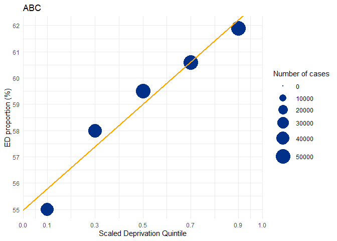

<!-- README.md is generated from README.Rmd. Please edit that file -->

# NHSOFearlystagecancer

<!-- badges: start -->
<!-- badges: end -->

This R package provides code for calculating the Slope Index of
Inequality (SII) used for the NHS Oversight Framework measure
Deprivation gap in early cancer diagnosis, either for use directly in R,
or as an example for translating into other tools.

## Installation

You can install the development version of NHSOFearlystagecancer from
[GitHub/nhsengland/NHSOFearlystagecancer](https://github.com/nhsengland/NHSOFearlystagecancer/)
with:

``` r
# install.packages("pak")
pak::pak("nhsengland/NHSOFearlystagecancer")
```

## Example

Given some early diagnosis data by deprivation quintile

``` r
library(NHSOFearlystagecancer)

example_df <- data.frame(
  date = rep(as.Date("2026-02-01"), 5),
  org_code = rep("ABC", 5),
  deprivation = c("1 - most deprived", "2", "3", "4", "5 - least deprived"),
  ed_prop = c(0.55, 0.58, 0.595, 0.606, 0.619),
  ed_denom = c(39546, 43663, 48796, 51117, 50739)
)

knitr::kable(example_df)
```

| date       | org_code | deprivation        | ed_prop | ed_denom |
|:-----------|:---------|:-------------------|--------:|---------:|
| 2026-02-01 | ABC      | 1 - most deprived  |   0.550 |    39546 |
| 2026-02-01 | ABC      | 2                  |   0.580 |    43663 |
| 2026-02-01 | ABC      | 3                  |   0.595 |    48796 |
| 2026-02-01 | ABC      | 4                  |   0.606 |    51117 |
| 2026-02-01 | ABC      | 5 - least deprived |   0.619 |    50739 |

We can get the SII with `derive_sii()`

``` r
example_result <- example_df |> 
  derive_sii(
    by = c("date", "org_code"),
    ed_prop_col = "ed_prop",
    ed_denom_col = "ed_denom",
    depr_col = "deprivation"
)

example_result[, c("org_code", "sii")]
#> # A tibble: 1 × 2
#>   org_code    sii
#>   <chr>     <dbl>
#> 1 ABC      0.0804
```

Note we are working with early diagnosis proportion on the scale of 0 to
1, so in this case we see an 8.04 percentage point difference between in
the proportion between the most and least deprived groups. That is our
deprivation gap.

We can also score the provided data with `score_sii()`. Scoring is done
by comparison to the mean SII, and here because we have only one set of
values, the result falls in group 3 for “*No evidence for a
smaller-than-average deprivation gap*”.

``` r
example_result <- score_sii(example_result, by = "date")

example_result[, c("org_code", "sii", "sii_score")]
#> # A tibble: 1 × 3
#>   org_code    sii sii_score
#>   <chr>     <dbl>     <int>
#> 1 ABC      0.0804         3
```

## Code for recreating elsewhere

You can view the code for the core functionality here:

- [derive_sii()](https://github.com/nhsengland/NHSOFearlystagecancer/blob/main/R/derive_sii.R)
  derive the SII across all groups in the provided data.

- [fit_sii()](https://github.com/nhsengland/NHSOFearlystagecancer/blob/main/R/fit_sii.R)
  the individual fitting of the regression model.

- [score_sii()](https://github.com/nhsengland/NHSOFearlystagecancer/blob/main/R/score_sii.R)
  compare the SII to the mean SII to assign the scoring group.

The documentation of `lm()` may also be useful for explaining the
implementation of regression by weighted least squares.

## Further examples

There is also a helper for visualising the fit of the model:
`plot_sii()`

``` r
example_result <- plot_sii(example_result, id = "org_code")

example_result$plot[[1]]
```



See `vignette("explain-SII")` for an explanation of the SII and scoring,
as well as applying the function across many ICBs.
