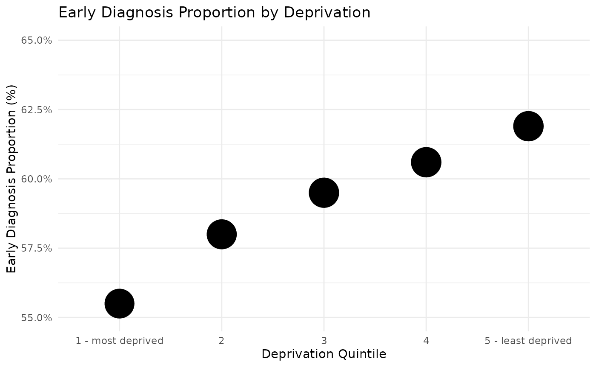
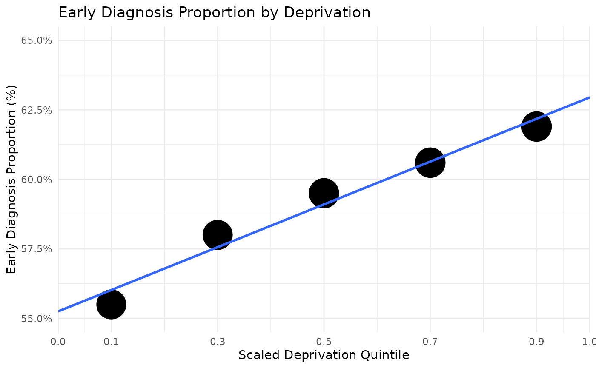
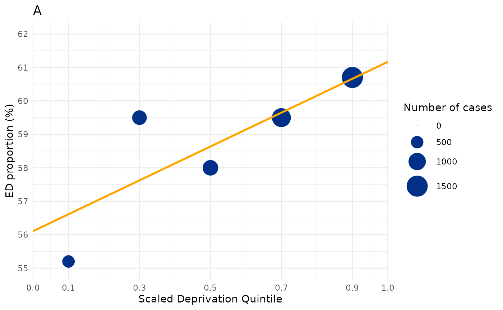
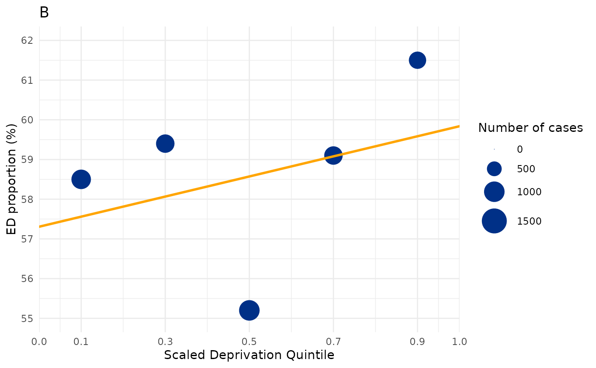
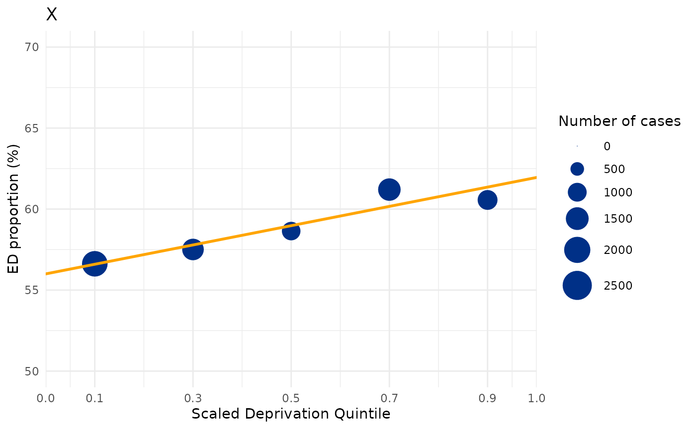

# How we measure the Deprivation Gap

## Introduction

This write-up describes how the metric Deprivation gap in early cancer
diagnosis is derived for the NHS Oversight Framework.

[NHS England » NHS Oversight Framework
2026/27](https://www.england.nhs.uk/long-read/nhs-oversight-framework-2026-27/)

### Definitions

To make sure we’re all on the same page, here’s some working definitions
for what we’re talking about.

**Early cancer diagnosis**

The proportion of cancers diagnosed at stage 1 and 2 out of all cancers
diagnosed at stages 1 to 4, observed over a 12-month period.

**Deprivation**

Uses Index of Multiple Deprivation (IMD) quintiles from 1 to 5,
representing the most deprived to least deprived areas in groups of 20%.
These quintiles are derived nationally, which makes it possible to
compare across geographies, but may mean some groups are
over/under-represented in different areas.

**Deprivation Gap**

The difference in early diagnosis proportion between those in the most
and least deprived groups. That is, a measure of the relationship
between deprivation and the early diagnosis of cancer.

**Slope Index of Inequality (SII)**

An SII is an absolute measure of inequality that represents the
difference in predicted values of an indicator between the most
advantaged and most disadvantaged subgroups, obtained by fitting a
regression model, or line of best fit. It is a standard method of
measuring inequality in public health, used by both Public Health
England (PHE) and the World Health Organisation (WHO).

PHE: [Technical Guidance - Slope Index of
Inequality](https://fingertips.phe.org.uk/static-reports/public-health-technical-guidance/Inequality/SII.html)

WHO Health Inequalities Handbook: [Summary measures based on ordered
inequality
dimensions](https://whoequity.github.io/book_2024/4_analysis-reporting/Chapter21.html)

### Why use a Slope Index of Inequality

The Slope Index of Inequality (SII) was selected because it provides a
robust and well-established measure of the relationship between
deprivation and early cancer diagnosis. At the all-cancer level there is
a strong linear relationship between deprivation quintile and the
proportion of cancers diagnosed at an early stage, making a
regression-based approach appropriate.

A key advantage of the SII is that it uses data from all deprivation
quintiles rather than relying solely on the most and least deprived
groups. This is particularly important at ICB level, where some
quintiles may contain relatively small numbers of cases. Simpler
measures, such as the change in the least deprived quintile over time or
the difference between quintiles 5 and 1, can be more sensitive to
random variation and are therefore less robust.

The SII is also a widely recognised measure of health inequality. It is
routinely used by the Office for Health Improvement and Disparities
(OHID) and is recommended by the World Health Organization (WHO) for
measuring and comparing inequalities across population groups.

## How we measure the gap

We’ll start with an example representing national early diagnosis by
deprivation.

``` r


example_df <- data.frame(
  deprivation = c("1 - most deprived", "2", "3", "4", "5 - least deprived"),
  ed_prop = c(0.555, 0.58, 0.595, 0.606, 0.619),
  ed_denom = c(39546, 43663, 48796, 51117, 50739)
)

example_df |> 
  transform(ed_prop = paste0(ed_prop * 100, "%")) |> 
  knitr::kable()
```

| deprivation        | ed_prop | ed_denom |
|:-------------------|:--------|---------:|
| 1 - most deprived  | 55.5%   |    39546 |
| 2                  | 58%     |    43663 |
| 3                  | 59.5%   |    48796 |
| 4                  | 60.6%   |    51117 |
| 5 - least deprived | 61.9%   |    50739 |

Visually, with the number of cases as the size of the points:

``` r


example_df |> 
  ggplot() + 
  aes(y = ed_prop, x = deprivation) +
  geom_point(aes(size = ed_denom)) +
  scale_y_continuous(labels = scales::percent, limits = c(0.55, .65)) +
  scale_size_continuous(limits = c(0, 55000), range = c(10, 12)) +
  labs(title = "Early Diagnosis Proportion by Deprivation",
       x = "Deprivation Quintile",
       y = "Early Diagnosis Proportion (%)") +
  theme_minimal() +
  theme(legend.position = "none")  
```



### Quintile 5 minus Quintile 1

As a point of reference, a simple and direct way to measure the distance
between the extremes would be to just take the difference between the
early stage proportion in quintiles 1 and 5.

\\ 61.9\text = 6.9 \text{pp} \\

Note we measure this as a percentage point (pp) for a difference between
percentages. So we could say the least deprived quintile has 6.9
percentage point higher chance of being diagnoses at an early stage than
the most deprived quintile.

### Building a line of best

The SII expands on this by including all deprivation quintiles and
fitting a linear regression model across them. For this purpose we scale
the deprivation quintile groups between 0 and 1. Each quintile is
assigned to the midpoint of the proportion of the population it
represents. For example, the first 20%, quintile 1, is placed at 0.1 (or
10%). This has the neat benefit that the regression model gradient
represents the change in early diagnosis proportion across the whole
deprivation range, instead of the change for a 1 unit increase in
deprivation quintile. With this we can take the gradient directly as the
value of the SII. This is equivalent to taking the difference between
the modelled early diagnosis proportion at 0 and 1 on the scaled axis,
which tends to give a larger gap than subtracting quintile 1 from
quintile 5 (which would sit at 0.1 and 0.9 on our scale).

``` r


example_df |> 
  ggplot() + 
  aes(y = ed_prop, x = c(0.1, 0.3, 0.5, 0.7, 0.9)) +
  geom_point(aes(size = ed_denom)) +
  geom_smooth(method = "lm", 
              formula = y ~ x,
              se = FALSE, 
              fullrange = TRUE) +
  scale_y_continuous(labels = scales::percent, limits = c(0.55, .65)) +
  scale_size_continuous(limits = c(0, 55000), range = c(10, 12)) +
  labs(title = "Early Diagnosis Proportion by Deprivation",
       x = "Scaled Deprivation Quintile",
       y = "Early Diagnosis Proportion (%)") +
  theme_minimal() +
  scale_x_continuous(
    limits = c(0, 1),
    breaks = c(0, 0.1, 0.3, 0.5, 0.7, 0.9, 1),
    expand = c(0, 0)
  ) +
  theme(legend.position = "none")  
```



### Adding weighting

Given that we are using nationall derived IMD quintiles, using even
spacing / weighting will not hold when we look at different
organisations, which will have a highly variable number of cases in
different quintiles. So, when fitting the regression line, not all
deprivation quintiles provide the same amount of information. A quintile
based on 1,500 staged cancers gives us a more precise estimate of the
early diagnosis proportion than a quintile based on only 300 cancers.

To account for this, we use weighted least squares regression. Each
deprivation quintile is assigned a weight based on the inverse variance
of a binomial proportion:

\\ w_i = \frac{n_i}{p_i(1-p_i)} \\

where:

- \\n_i\\ is the number of staged cancers in deprivation group \\i\\
- \\p_i\\ is the early diagnosis proportion in deprivation group \\i\\
- \\w_i\\ is the weight applied in the regression

This weighting reflects the statistical precision of each observed
proportion. Larger groups receive more weight because they contain more
information, while proportions close to 50% receive slightly less weight
than proportions near 0% or 100%, as binomial variance is greatest when
\\p = 0.5\\.

Consider two fictional ICBs:

``` r

icb_example <- tibble::tribble(
  ~icb, ~deprivation,       ~ed_prop, ~ed_denom,
  "A", "1 - most deprived",  0.552,   500,
  "A", "2",                  0.595,   700,
  "A", "3",                  0.580,   800,
  "A", "4",                  0.595,   1200,
  "A", "5 - least deprived", 0.607,   1500,
  "B", "1 - most deprived",  0.585,   900,
  "B", "2",                  0.594,   800,
  "B", "3",                  0.552,   1000,
  "B", "4",                  0.591,   800,
  "B", "5 - least deprived", 0.615,   700,
)
```

We’ll fit the SII for each using our package function:

``` r

icb_example <- icb_example |> 
  derive_sii(
    by = "icb", 
    ed_prop_col = "ed_prop",
    ed_denom_col = "ed_denom",
    depr_col = "deprivation"
  )
```

Then use a helper function to visualise the fit for each organisation:

``` r

icb_example <- plot_sii(icb_example, id = "icb")
```

Looking at ICB A we can see the linear model working fairly well, but
also see that more precise points are favoured. The line is much closer
to the quintiles with more cases than especially the first quintile with
less.

``` r

icb_example$plot[[1]]
```



ICB B has more variability between quintiles, with a smaller deprivation
gap, but a poorer fitting model as the relationship is less clearly
linear.

``` r

icb_example$plot[[2]]
```



## Oversight Framework Scoring

The 1-4 scoring for the cancer early diagnosis (ED) deprivation gap, is
as defined in the table below. This shows that ICB scoring is based on
both the difference from the England average and the size of the
statistical variation (standard deviation) associated with this gap. The
statistical variation here measures how close a correlation there is
between ED and deprivation, and whether this is based on a larger or
smaller number or patients. For example, it’s possible that an ICB with
a smaller deprivation gap but more statistical variation may score lower
than an ICB with a larger gap but less variation.

| SII score | Description |
|:---|:---|
| 1 | Strong evidence for a smaller-than-average deprivation gap: More than 2 Standard Errors below the England average. |
| 2 | Some evidence for a smaller-than-average deprivation gap: 1-2 Standard Errors below the England average |
| 3 | No evidence for a smaller-than-average deprivation gap: 1 Standard Error below to 1 Standard Error above the England average |
| 4 | Evidence for a larger-than-average deprivation gap: More than 1 Standard Error above the England average |

With our example ICBs we showed the SII and also the standard error of
the SII. If we had a mean of 9 percentage points gap across all ICBs in
England, and compare that back this to our outputs:

``` r

icb_example |> 
  subset(select = c("icb", "sii", "sii_std_err")) |> 
  transform(sii = paste0(round(sii, 4) * 100, " p.p."),
            sii_std_err = paste0(round(sii_std_err, 4) * 100, " p.p.")) |> 
  knitr::kable()  
```

| icb | sii       | sii_std_err |
|:----|:----------|:------------|
| A   | 5.06 p.p. | 1.92 p.p.   |
| B   | 2.53 p.p. | 4.07 p.p.   |

We can see that ICB A would fall into group 1, because \\9 - 2 \times
1.92 = 5.16\\, and \\5.06\\ is less than that. ICB B would score in
group *2* because \\9 - 2 \times 4.07 = 0.86\\, and \\9 - 4.07 = 4.93\\,
where \\2.53\\ falls in that 1 to 2 standard errors range. Thus an
organisation with a lower deprivation gap might not score as well,
because there is less confidence in the fit of the model.

## Applying this package across all organisations

First some dummy data, an org with random values for each letter of the
alphabet in `icb_dummy_data`.

``` r

glimpse(NHSOFearlystagecancer::icb_dummy_data)
#> Rows: 130
#> Columns: 5
#> $ date        <date> 2026-01-01, 2026-01-01, 2026-01-01, 2026-01-01, 2026-01-0…
#> $ org_code    <chr> "A", "B", "C", "D", "E", "F", "G", "H", "I", "J", "K", "L"…
#> $ deprivation <chr> "1 - most deprived", "1 - most deprived", "1 - most depriv…
#> $ ed_prop     <dbl> 0.5702109, 0.5890953, 0.5238341, 0.5642493, 0.5604751, 0.5…
#> $ ed_denom    <dbl> 1678, 2228, 1910, 1396, 2336, 1575, 1625, 298, 2255, 821, …
```

We can get the SII and score for each of them, with a simple pipeline,
as long as we correctly specify the groups with the `by` argument:

``` r

icb_results <- NHSOFearlystagecancer::icb_dummy_data |>
  derive_sii(
    by = c("date", "org_code"),
    ed_prop_col = "ed_prop",
    ed_denom_col = "ed_denom",
    depr_col = "deprivation"
  ) |>
  score_sii(by = "date") |> 
  plot_sii(id = "org_code")

icb_results |> 
  select(date, org_code, sii, sii_std_err, sii, sii_mean, sii_score)
#> # A tibble: 26 × 6
#>    date       org_code      sii sii_std_err sii_mean sii_score
#>    <date>     <chr>       <dbl>       <dbl>    <dbl>     <int>
#>  1 2026-01-01 A         0.0413      0.0177    0.0539         3
#>  2 2026-01-01 B        -0.00236     0.0115    0.0539         1
#>  3 2026-01-01 C         0.0482      0.0489    0.0539         3
#>  4 2026-01-01 D         0.0404      0.0269    0.0539         3
#>  5 2026-01-01 E         0.0550      0.0317    0.0539         3
#>  6 2026-01-01 F         0.0173      0.00954   0.0539         1
#>  7 2026-01-01 G         0.0802      0.0462    0.0539         3
#>  8 2026-01-01 H         0.0902      0.0288    0.0539         4
#>  9 2026-01-01 I         0.0299      0.0208    0.0539         2
#> 10 2026-01-01 J        -0.0305      0.0288    0.0539         1
#> # ℹ 16 more rows
```

With a plot for each organisation:

``` r

icb_results |> 
  filter(org_code == "X") |> 
  pull(plot)
#> [[1]]
```


